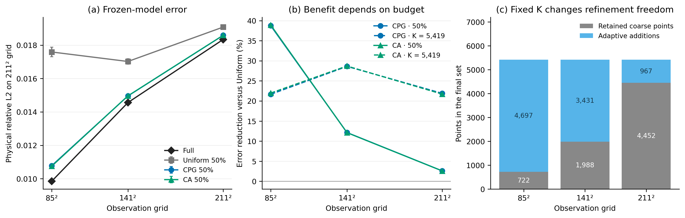

# E4：Darcy 观测分辨率迁移（当前结果）

<!-- darcy-resolution-matched-training-20261117 -->
## 新增：各观测分辨率独立训练

[完整 resolution-matched 结果](resolution_matched_20261117/README.md)已完成：85²、141²、211² 分别从头训练，采用同一 train900/validation100 划分、1000 epochs 和 training seed 0，并各自训练 CA head。全部 22,200 个预测请求和 44,400 行 common/native 指标已验收。

该补充直接检验训练分辨率匹配后的表现。作者主表保留原文 85² 历史参考＋新 141²/211²；受控趋势使用新的 85²/141²/211²。下面的冻结模型迁移及 PI β 校准仍是各自独立协议。
<!-- /darcy-resolution-matched-training-20261117 -->

<!-- darcy-pi-beta-calibration-20261117 -->
## 最新补充：PI 的 β 校准

[共享β=1及按分辨率校准的完整结果](pi_beta_calibration_20261117/README.md)已完成并核验。共享β=1的三个测试均值为 **0.998995、0.971548、0.969888**，均低于1；85²略差于原β0.5且仅1/3个sampling seeds低于1。此次使用额外100例校准数据，在测试前锁定β，再产生22,200条测试记录。

以下保留原固定β=0.5的E4观测分辨率分析。新校准值没有冒充原冻结策略结果；所有候选、不利结果和211²平均方法排序的变化均在补充包中报告。
<!-- /darcy-pi-beta-calibration-20261117 -->

**原固定β观测分辨率分析，更新于2026-11-17。** 以下分析从既有记录复算rAUEC、固定点数比较和区域平方误差；这部分没有新增推理，原27,000次请求保留。其后新增的PI β校准和测试结果见上方独立补充。

[完整分析](REPORT.md) · [本次修改清单](UPDATE_20261117.md) · [协议](protocol.md) · [数值审计](derived_analysis/publication_review.json) · [文件清单](release_manifest.json)

## 实验是什么

- 同一个85×85全网格训练的Transolver3，1000 epochs、training seed=0；固定normalizer和CA head。
- 同200个smooth2物理样本；从真实421²源场直接取stride5/3/2，形成85²/141²/211²观测。
- 所有主要误差统一在真实211²评价网格上计算。非Full用sampling seeds0/1/2；这里不是三个独立训练seed。
- 历史checkpoint/策略开发查看过该测试人群。该组为冻结模型的观测密度迁移，不能解释成三个分辨率分别重训的对照。

## 当前结论

冻结推理流程的完整场误差随观测分辨率增加而升高。同保留比例下，CPG/CA相对Uniform的收益缩小；同样只保留5419点时，CPG仍降低约22%–29%的误差。固定K还改变了coarse规模及自适应新增空间，因此尚不能把退化单独归因于模型token数或beta补偿。

| 观测网格 | Full relative L2 | CPG对Uniform降幅：50%预算 | CPG对Uniform降幅：固定5419点 | 固定K中coarse占比 |
| --- | ---: | ---: | ---: | ---: |
| 85² | 0.009845 | 38.75% | 21.67% | 13.3% |
| 141² | 0.014560 | 12.15% | 28.62% | 36.7% |
| 211² | 0.018342 | 2.59% | 21.90% | 82.2% |



图中固定K的coarse占比变化不适用于固定50%比例：后者coarse占最终点数约20%不变，但coarse绝对数量及CA上下文仍增加。CPG/CA的最终集合确实保留整个coarse前缀，已在18个保存的真实点集中核验。

区域离线分解显示，85²→211²新增的平均归一化平方误差约63.2%位于平滑区、28.2%位于边界区、8.7%位于界面区。它定位误差分布，不确定唯一成因，也不是对平均relative L2的直接可加分解。

## 原记录与新派生统计

| 文件 | 含义 |
| --- | --- |
| [resolution_budget.csv](resolution_budget.csv)、[fixed_points.csv](fixed_points.csv) | 原始比例/固定点数汇总，保持原字节 |
| [metrics_records.csv](metrics_records.csv)、[region_summary.csv](region_summary.csv) | 原54,000行common/native指标与区域汇总，保持原字节 |
| [derived_rauec.csv](derived_analysis/derived_rauec.csv) | 每sampling seed积分并除以匹配Uniform，再算均值和sampling SD；Full不入积分 |
| [strategy_comparisons.csv](derived_analysis/strategy_comparisons.csv) | 同条件收益与每case配对胜出数 |
| [fixed_budget_composition.csv](derived_analysis/fixed_budget_composition.csv) | 最终5419点中的强制coarse/新增adaptive点 |
| [region_energy_inputs.csv](derived_analysis/region_energy_inputs.csv) | 1800行区域指标与真值范数标量，支持独立重构区域能量 |
| [region_error_energy.csv](derived_analysis/region_error_energy.csv) | 9行区域平方误差贡献；细分数据及数值残差另附 |

## 解释边界

三个stride网格并不逐级嵌套；Full85/141需要重建到211，Full211为identity。旧PI采用展平mask的一维EDT，CPG沿用物理距离分数与index-Laplacian的组合，CA head没有针对新增上下文重训。这些均属于被测冻结协议，修正版必须另立协议重新评价。

表内耗时仅为精度请求伴随的一次wall-time观测，不能替代正式20 warmup＋100 repeats的时延实验。Full是实测参照，不是误差下界。本更新也不覆盖独立的Darcy三训练seed或900/100双backbone matched实验。

## 复算

从仓库根目录运行，无需GPU、模型权重或私有预测数组：

```bash
python3 reproducibility/rebuttal/2026-11/E4/recompute_e4_analysis.py \
  --data-dir data/rebuttal/2026-11/E4 --output-dir /tmp/e4-derived-check
```

公开复算使用本目录原始与派生CSV。重建原区域掩码、真值范数或重验保存的选点前缀需要原开发机数据，步骤和来源在[复现说明](../../../../reproducibility/rebuttal/2026-11/E4/README.md)。

## English scope

This update supersedes the former brief E4 explanation with an audited analysis of the same 27,000 frozen-model requests. A single 85²-trained checkpoint is evaluated on true 85²/141²/211² observations of 200 common cases, with a shared 211² evaluation grid. Three seeds refer to inference sampling. At a fixed 5,419 points, CPG retains a 21.7%–28.6% mean-error reduction versus matched Uniform, while absolute errors increase. Coarse contexts, non-nested observations, scoring scales and reconstruction paths limit causal attribution. No new training, inference, or formal timing is claimed.
