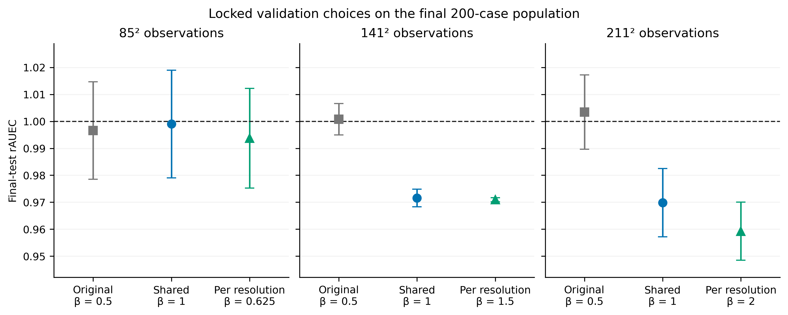

# Darcy PI β 校准：完整结果

**已完成：32,700 条校准记录、22,200 条测试记录及独立核验。** 在新校准版本中，三个分辨率共享 β=1，平均 rAUEC 均低于1。原E4固定β=0.5的实验记录保留为基线。

[中文完整报告](REPORT_zh.md) · [共享参数配置](config/primary_shared_beta1.json) · [全部测试rAUEC](results/test_rauec.csv) · [下载完整压缩包](download/darcy_pi_beta_calibrated_results_20261117.zip) · [独立最终审计](results/independent_final_audit.json)

## 原配置与校准结果

| 观测网格 | 原β=0.5 | 共享β=1 | β=1中低于1的sampling seeds | 分辨率校准β | 分辨率校准rAUEC |
| --- | ---: | ---: | ---: | ---: | ---: |
| 85² | 0.996622 ± 0.018057 | 0.998995 ± 0.019993 | 1/3 | 0.625 | 0.993774 ± 0.018484 |
| 141² | 1.000776 ± 0.005778 | 0.971548 ± 0.003287 | 3/3 | 1.5 | 0.970917 ± 0.000803 |
| 211² | 1.003448 ± 0.013816 | 0.969888 ± 0.012662 | 3/3 | 2 | 0.959246 ± 0.010756 |

±是同一个冻结训练模型下三个sampling seeds的样本标准差。**85²共享β=1略差于原β=0.5，并且仅1/3个sampling seeds低于1。** 三个均值都低于1，不等于每个seed都改善。



## 实验类型与固定条件

这是对既有E4 checkpoint的参数校准，未重新训练backbone。保留原normalizer、PI先验、amp=0.25、ell=2/84、选点和共同211²评价网格；仅改变补偿指数。相同case/预算/seed下所有β使用完全相同的有序点集。原flattened-mask EDT语义也保留，未在本次顺带更换采样算法。

- 校准：smooth2 rows400–499，共100例，global IDs1400–1499，与旧E4测试人群不重叠。
- 固定候选：0、0.125、0.25、0.375、0.5、0.625、0.75、0.875、1、1.5、2。
- 主方案：选择使三个分辨率最差校准rAUEC最小的共享β，结果为1。
- 次级方案：各分辨率分别用校准集选β，结果为0.625／1.5／2，单独报告。
- 测试：锁定selection.json后，评估原200个E4 case、三个预算和三个sampling seeds。测试值不重新选择β。
- 1.5／2是预声明的过补偿候选，不称为0–1 tempering或精确inclusion-probability correction。

原checkpoint和策略存在历史test-informed背景。本次校准人群与旧测试人群分离，但不将该测试集描述为从未查看的holdout。两个方案均使用过所测分辨率的校准信息，因此应标为校准PI，不能回写成原冻结β协议自然取得的结果。

## 对原E4方法排序的影响

在211²上，校准PI（共享β=1）的mean rAUEC为0.969888，低于原冻结CPG的0.976785及CA的0.976940。比较表已保留这一均值排序；PI获得了额外校准，而CPG/CA保持原配置，不能据此声称相同调参预算下显著优于二者。85²和141²下原CPG/CA均值仍更低。详见[上下文比较](results/context_with_frozen_E4.csv)。

## 交付内容与核验

- `records/*.csv.gz`：六份无损压缩的全部校准/测试原始记录，包含point hash及模型、normalizer、selection身份。
- `results/`：所有校准候选、最终预先选定条件、绝对误差、逐seed曲线、配对变化和独立审计。
- `config/`、`protocol.json`、`selection.json`：可用配置与测试前锁定的选择。
- `figures/`：四组PDF/SVG/300dpiPNG，均附源CSV与说明，保留高于1的值及不利变化。
- `code/`、`sources/`、`runtime/`：实际运行/统计/绘图脚本、执行分片的来源快照与记录。
- `provenance/development_delivery_manifest.json`：原开发包/ZIP的清单；当前公开路径以`release_manifest.json`为准。
- 大权重、完整预测NPZ、数据缓存和长日志保留在内部路径。此处没有正式时延或速度结论。

独立审计确认11,400条Full／Uniform／原β=0.5对照与原E4误差差为0；5,400组PI条件的β间选点一致。统计复算最大差2.22e-16。

## 无GPU复算

```bash
python3 verify_published.py --package . --output /tmp/darcy-pi-beta-check.json
```

复算器会无损解压六份raw CSV到临时目录，保持protocol、selection及原summarize.py的字节身份，重新核对校准选择和全部测试汇总。原数据不会被改写。重新执行模型推理需要protocol中的内部数据/权重。

## English summary

This completed study calibrates only the PI compensation exponent on100 disjoint cases before evaluating the original200-case E4 population. A shared beta of1 yields mean rAUEC0.998995,0.971548 and0.969888 at85²,141² and211². The85² result is slightly worse than the original beta0.5 and only one of its three sampling seeds is below1. The separately declared resolution-calibrated choices are0.625,1.5 and2. All candidates and adverse outcomes remain available. These are calibrated policies with one frozen training checkpoint, not replacement observations for the original fixed-beta experiment.
