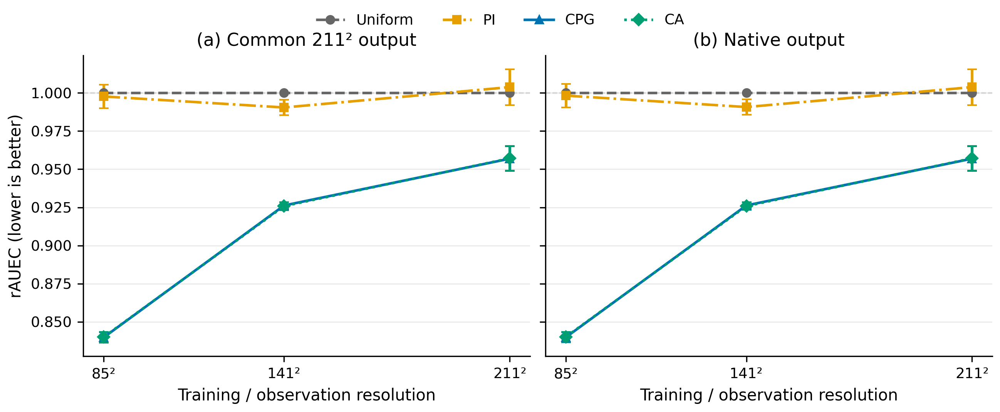

# Darcy：分辨率匹配训练完整结果

**实验类型：Darcy observation-density resolution-matched training。训练、完整场推理和结果验收均已完成。**

本轮分别在真实 85²、141²、211² 观测网格上从头训练 Transolver3，并为每个 backbone 单独训练 CA head。三组均使用同一 900/100 物理 case 划分、1000 epochs、有效 batch 4、training seed 0；评价使用 sampling seeds 0/1/2。这里的三种分辨率不是三个独立 training seeds。

[完整报告](REPORT.md) · [作者 rebuttal 主表](results/tables/rebuttal_main.md) · [受控 common-grid 表](results/tables/controlled_common.md) · [native-grid 表](results/tables/controlled_native.md) · [全部图](figures/README.md) · [实验协议](protocol.md) · [修改说明](UPDATE.md)

## 受控分辨率趋势：共同 211² 输出网格

| Method | Matched 85² | Matched 141² | Matched 211² |
|---|---:|---:|---:|
| UNIFORM | 1.000000 ± 0.000000 | 1.000000 ± 0.000000 | 1.000000 ± 0.000000 |
| PI | 0.997666 ± 0.007755 | 0.990438 ± 0.004978 | 1.003769 ± 0.011801 |
| CPG | 0.839759 ± 0.003326 | 0.926239 ± 0.002305 | 0.956905 ± 0.008050 |
| CA | 0.840044 ± 0.003376 | 0.925838 ± 0.002622 | 0.957131 ± 0.008072 |

**211² 的 PI rAUEC 为 1.003769 ± 0.011801，均值高于 Uniform 的 1。** 本轮没有用测试结果再次调 β，也没有将这项结果改写为改善。

每个 sampling seed 先求 200 个 case 的三个预算平均误差，对 37.5/50/75% 做梯形积分，再除以本模型、本分辨率、本 seed 的 Uniform 面积；最后报告三个面积比的 mean ± sample SD。Full 每个 case 仅评价一次，100% 不进入积分。

在相同211²输出网格上，85²→141²→211²独立训练后的rAUEC，PI为0.9977 → 0.9904 → 1.0038；CPG为0.8398 → 0.9262 → 0.9569；CA为0.8400 → 0.9258 → 0.9571（sampling seeds=3，training seed=0）。

PI的边界保留率高于全局预算有0/9个条件，平滑区低于全局预算有9/9个条件；CPG的边界保留率高于全局预算有9/9个条件，平滑区低于全局预算有9/9个条件；CA的边界保留率高于全局预算有9/9个条件，平滑区低于全局预算有9/9个条件（条件为3个分辨率×3个预算，先按case和sampling seed聚合）。



## 与历史 E4 的关系

作者主表保留“原文 85² 历史参考＋新增 141²/211²”；新的 85² 只用于同协议内部趋势分析。原文 85² 的训练/选择历史、PI β 和 native85 评价口径与本轮不同，不将历史列视为受控趋势的一员。此前冻结 85² 模型的 observation-density 迁移及 PI β 校准仍保留在父 E4 目录。

## 完成范围与修改

- 三个从头训练 backbone，加三个各自绑定权重的 CA heads；每个均完成 1000 epochs。
- 200 个共同测试 case，Full/Uniform/PI/CPG/CA，三个预算与 sampling seeds 0/1/2。共 22,200 个实际预测请求、44,400 行 common/native 指标、66,600 行区域记录。
- 真实 421² 源场按 stride 5/3/2 直接取节点；normalizer 仅拟合 train900，checkpoint 和 head 仅由 validation100 选择。
- PI 使用预先锁定的共享 β=1；CPG/CA 保留 E4 配置，coarse_fraction=0.1 并计入最终预算；未因本轮结果重新调参。
- 保留原 E4 重建规则与策略数学定义；common211 和 native 指标分开提供。
- 区域统计改为直接在各原生坐标上应用共同的物理带宽。旧的最近邻布尔标签映射在 141² 上把 301 个距边界 0.021428、超过 0.02 带宽的节点纳入 boundary；旧区域 CSV 以 legacy 保留，严格带宽版本作为主分析。该离线统计纠正不改变训练、实际选点或 44,400 行完整场误差，也不作为训练分辨率效果解释。
- Head 验收恢复原 bank 生成时的 batch 8 复现方式，并保留原差异诊断。该修复发生在验收器，未修改已训练权重、采样规则或重建算法。详见 provenance 中的修复记录与各 head 验收收据。
- 13 组图均提供 PDF、SVG、300 dpi PNG；原始数值和不利结果全部保留。没有用单次精度请求时长声称正式推理加速。

## 文件与复算

| 路径 | 内容 |
|---|---|
| `records/r*/metrics_records.csv.gz` | 完整逐 case/预算/sampling seed 的 common/native 指标及 retained-index hashes |
| `records/r*/physical_region_records.csv.gz` | 主区域分析：严格物理带宽的实际选点数、保留率、score 与目标分布统计 |
| `records/r*/region_records.csv.gz` | 保留的 legacy 最近邻布尔标签区域记录，未用于主区域图 |
| `results/` | 所有汇总、逐 seed rAUEC、绝对误差、表格、验收记录、checkpoint registry |
| `figures/` | 13 组图、图注与绘图源 CSV |
| `checkpoints/` | Backbone/head 训练 manifest、曲线和源码快照；大权重由索引定位 |
| `code/` | 实际训练、采样、评价、统计、绘图代码与冻结 vendor 源码 |
| `internal_artifacts.csv.gz` | 内部权重、完整选点/预测数组、原生数据缓存的路径与 hashes |
| `download/darcy_resolution_matched_20261117_results.zip` | 可下载的紧凑结果包 |

```bash
python3 verify_published.py --package . --output /tmp/darcy-matched-check.json
python3 render_published.py --package . --output /tmp/darcy-matched-render
```

第一条使用 Python 标准库，从公开的无损 CSV 复算指标和 rAUEC；第二条使用 NumPy、pandas、SciPy、Matplotlib，从公开绘图 CSV 调用原绘图函数，无需 GPU 或模型权重。重新训练或重跑推理需要内部索引中的源数据与权重，实际命令见 REPRODUCE.md。开发机 GPU 调度器还依赖相邻 AdaSolver_official 的 inference_speed.nvml 辅助模块；它不参与公开 CSV 的数值复算或绘图。测试人群曾在历史工作中被查看；本轮未将其用于模型或策略选择。

## English scope

This study adds resolution-matched training at 85², 141² and 211² with the same contiguous 900/100 split, 1000 epochs and training seed 0, plus a dedicated CA head for each backbone. The complete test matrix contains 22,200 physical requests and 44,400 common/native metric rows. Three sampling seeds quantify sampling variability, not training variability. The historical paper85 column is retained only as a labelled reference; controlled trends use the three newly trained models.
