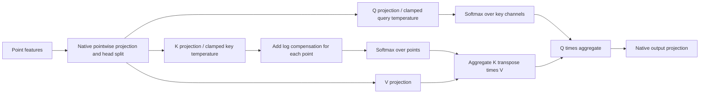

# Airfoil native model compatibility

The source is official LinearNO commit3f2b80df13c17a09e250f2ebe4d4ecdfd4acf269. The Standard PDE source differs from the ShapeNet-Car source: its `key_ratio` argument is the absolute key width, not a multiplier of per-head channel count. The selected value64 therefore produces64 key/query channels per head.

The official Airfoil shell script uses `LinearNO_Conv_temp`, width128,8 layers,8 heads, MLP ratio1 and key width64. Its first attention projection reshapes the full point axis to221×51 and performs a spatial3×3 convolution. An arbitrary43-point input raises the native `EinopsError` because43≠11271. The full11271-point input returns a finite[1,11271,1] output. The incompatibility is retained rather than hidden by reshaping or filling missing points.

The main variable-point comparator is the same official file's existing `LinearNO_temp` branch (`args.model='temp'`). It is not a convolutional model with its body changed. It keeps the native learned query/key temperatures, pointwise input projection, query channel softmax, key point softmax and native output projection. Width/depth/head/key settings match the official standard script; the native MLP ratio1 is retained. This has585217 parameters. T3 retains its actual paper configuration and has977345 parameters. Equal feature width/depth does not imply equal parameter count.

Airfoil's model target is changed at the dataset boundary from the official script's Mach channel4 to the requested pressure channel3. Both backbones share the same900/100 split, train-only pressure normalization and physical pressure relative-L2 loss. T3's native input concatenates xy twice through pos/fx; official LinearNO takes xy with fx=None. They encode the same geometry information with their native interfaces preserved.

The unsupported convolutional variant is separately trained as a full-grid supplement (1765889 parameters); it is not assigned subsampling rAUEC or described as a variable-point transfer result.

CPU interface checks cover two arbitrary point counts and batch2, finite forward/backward for all trainable parameters, unit compensation, and weighted-key aggregation against explicit integer duplication. The point-temp duplication test differs by at most3.20e-7 in absolute output. Results are inresults/interface_validation.json; these checks are implementation evidence, not trained prediction performance.

The point-temp aggregation chain, including its only compensation site, is:

The correction is added **after** the native key-temperature scaling and only before the key's point-axis softmax. Query normalization, value projection and output projection retain their native definitions. Weighted key aggregation has the expected discrete-mass interpretation, as confirmed by the explicit-duplication implementation check. This does not transfer Transolver-specific slice approximation bounds to LinearNO and does not guarantee that beta=1 minimizes learned-model field error.
