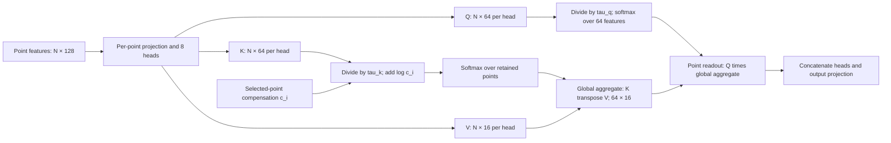

# Official point-temp aggregation and correction

Source: [HiPRL/LinearNO](https://github.com/HiPRL/LinearNO), commit `3f2b80df13c17a09e250f2ebe4d4ecdfd4acf269`, `LinearNOStandard/model/LinearAttnNeuralOperator.py`. The instantiated outer class is `LinearAttentionNeuralOperator`, with eight existing official `LinearNO_temp` blocks. Width is 128, eight heads have value width 16, and the standard implementation's `key_ratio=64` means absolute key dimension 64. It is not the multiplier convention used by the Car source.

For a head, point index (i), key feature (j) and value channel (ell), the adapter computes

\[
\widetilde Q_{ij}=\frac{\exp(Q_{ij}/\tau_q)}{\sum_a\exp(Q_{ia}/\tau_q)},
\qquad
\widetilde K_{ij}=\frac{c_i\exp(K_{ij}/\tau_k)}{\sum_s c_s\exp(K_{sj}/\tau_k)},
\]

\[
G_{j\ell}=\sum_i\widetilde K_{ij}V_{i\ell},
\qquad
Y_{i\ell}=\sum_j\widetilde Q_{ij}G_{j\ell}.
\]

Both temperatures are clamped to the official standard source range [0.01, 1]. The compensation is added to the key logits *after* temperature division, so it represents exactly multiplication by (c_i) inside the point-normalized measure. Query feature normalization, values, residual paths and feed-forward layers retain the official implementation. With no compensation context, the original official forward is called directly.

The interface check verifies unit-weight equivalence and, for fixed layer inputs, equivalence between positive integer weights and corresponding repeated points. These are implementation identities of this aggregation. They do not transfer every Transolver slice-attention theorem to a different architecture or prove that β=1 minimizes finite-sample prediction error.

For this experiment, CPG/CA use the native Voronoi-mass compensation; PI uses its locked inverse-proposal weight. These are distinct density constructions. In particular, weighted sampling without replacement does not make the proposal probability equal to final inclusion probability. The matched β=0/1 CPG comparison therefore keeps one actual coarse prediction and one actual selected-index array and changes only compensation. The final matrix will determine its empirical effect; no test-selected β enters the main table.

The official `LinearNO_Conv_temp` alternative requires reshaping tokens to 85×85. A real 2,709-point input failed with `EinopsError: 2709 != 7225`, while Full succeeded. It remains an additional untouched Full-only baseline; the point-temp variant is identified separately.

The pinned upstream snapshot contains no discovered LICENSE or package license declaration. `config/source_record.json` records that observation. The local snapshot is retained internally; this task does not publish it or push the paper repository.
