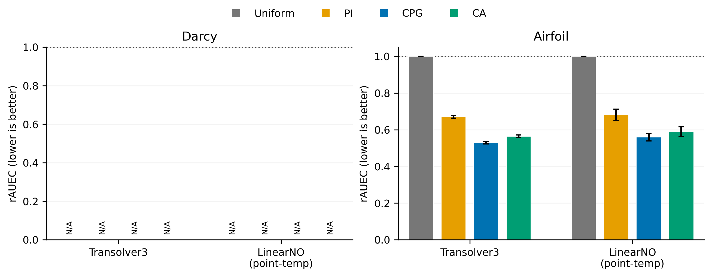
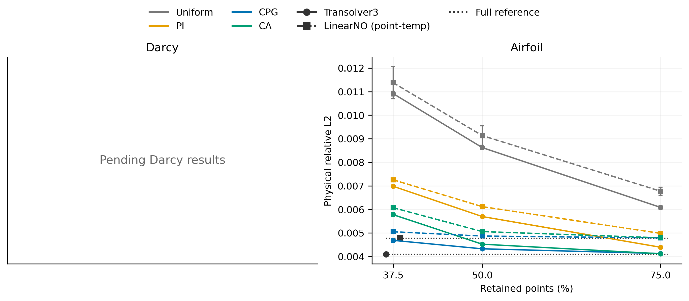

# LinearNO 补充实验：匹配训练、β 配对消融与重建验收

**发布状态：阶段结果，整轮实验尚未全部完成。** 本分支发布已验收的 Airfoil 两个点模型及各自 CA head 的完整精度矩阵，以及重建实现和正确性记录。官方 conv-temp 的 Full 补充也已完成；Darcy 新训练、Car 全量复评和正式端到端计时仍列为待完成。

本目录对应本轮重新锁定的 **900 train + 100 validation、training seed=0** 配对实验。误差条来自 **sampling seeds=0/1/2**，不代表三个独立训练模型的标准差。已有历史复用和额外 training-seed 实验属于其他证据集。

## 实验类型与完成范围

| 编号 | 实验类型 | 数据与配置 | 本次状态 | 结果入口 |
| --- | --- | --- | --- | --- |
| E3-A | 重新训练的跨 backbone 对照 | Airfoil 221×51 pressure；Transolver3 / 官方 LinearNO point-temp；共同 900/100 划分 | 完成两个 backbone 的 1000 epochs / 113000 updates，及全部精度条件 | [绝对误差](E3_standard/results/backbone_absolute_errors.csv) |
| E3-B | 固定选点的补偿机制消融 | CPG β=0/1；同粗预测、同最终点集；三个预算、三个 sampling seeds | 完成 1980 组跨模型配对 | [β 对照表](E3_standard/tables/cpg_beta_pairs.md) |
| E3-C | 各 backbone 自身特征的 CA 迁移 | 冻结各自 backbone，分别训练 200 epochs 的压力 head | 两套 head 及 CA 精度验收完成 | [head 与训练成本](E3_standard/airfoil/results/training_head_cost.csv) |
| E1-A | 数学规则不变的重建实现优化 | GPU sparse gather/scatter；保留原坐标精度、QHull/IDW、fallback 与回填规则 | 统一 API v1.1 固定预测验收完成；两个新 Airfoil checkpoint 全测试 old/new 对照通过 | [重建注册表](E1_reconstruction/reconstruction_registry.json) |
| E1-B | 独立 exact-kNN 候选审计 | 分块穷举检索、重复点/tie/输入守卫 | CPU 审计及一个真实 Car 样例通过；GPU 候选未验收 | [候选审计](E1_reconstruction/results/gpu_knn_candidate_guard_audit.md) |
| E3-D | 新增 standard benchmark | Darcy 85×85，匹配 900/100 划分与训练目标 | 等待 GPU；实现和锁定协议已提交，精度结果 N/A | [Darcy 协议](E3_standard/darcy/protocol.md) |
| E3-E | 官方固定网格 Full 参照 | LinearNO conv-temp；与 point-temp 明确分开 | Airfoil Full 训练及精度验收完成 | [兼容性说明](E3_standard/airfoil/model_compatibility.md) |
| E1/E3-F | 完整输出效率实验 | A: CPU→CPU；B: GPU→GPU；C: 相同几何/选点映射复用 | 正式时延与显存矩阵待空闲 GPU；不报告加速比 | [统一协议](E3_standard/protocol.md) |

## 已完成的 Airfoil 结果

固定发布的 **110 个 true Cl>0.02 case**，共同完整评价网格，物理空间 pressure relative L2。下表除 Full 行外均为 rAUEC，越低越好；各 backbone 用自己的 Uniform 面积归一化。每个 seed 先算 case 平均误差曲线的面积比，再报告三个 seed 的均值和样本 SD。

| 指标 / 方法 | Transolver3 | 官方 LinearNO point-temp |
| --- | ---: | ---: |
| Full：physical relative L2 | 0.0040926861 | 0.0047750134 |
| Uniform rAUEC | 1.000000 ± 0.000000 | 1.000000 ± 0.000000 |
| PI rAUEC | 0.671098 ± 0.007489 | 0.680622 ± 0.030819 |
| CPG β=0 rAUEC | 7.901202 ± 0.267334 | 6.201754 ± 0.238420 |
| CPG β=1 rAUEC | 0.529345 ± 0.006744 | 0.559296 ± 0.021060 |
| CA rAUEC | 0.563249 ± 0.007347 | 0.589981 ± 0.025945 |

**固定网格补充：** 官方 LinearNO conv-temp 的 Full physical relative L2 为 **0.0027917439**，不参与 rAUEC。它采用完整网格训练，与两个主模型的变量点数训练分开标注。其训练允许默认 cuDNN TF32；最终测试与正式计时禁用该设置。新增验收见 [conv Full 审计](verification/publication_conv_audit.json)。

在这个固定协议和人群上，β=1 优于相同选点的 β=0，CA 略弱于 CPG β=1。其他 β 未在新测试集调优。上述配对结论不构成 β=1 在所有任务上的最优性证明。不同 backbone 的 rAUEC 分母不同，绝对精度比较请看 Full 和误差—预算表。

两个点模型主矩阵共 **10120 次实际预测、80960 行四指标 old/new 记录、20240 行 field 记录**，每个模型 5060 次预测。另有官方 conv-temp 的 110 次 Full 预测和 880 行指标，Airfoil 合计 **10230 次预测、81840 行指标、20460 行 field 记录**。完整场 old/new 最大绝对差为 **4.44e-16**，逐元素容差违规为 0。独立复算覆盖 20 行 rAUEC 与 66 行绝对误差汇总，最大统计差 **3.55e-15**。验收范围见 [独立审计](verification/publication_audit.json)。





## 修改了什么

1. 增加统一 reconstruction v1.1 接口，分离映射构建与权重应用；主请求计入与本次选点相关的构建及传输成本；缓存键包含实际几何、坐标 dtype、选点顺序和规则版本。
2. 增加 official LinearNO point-temp 的正确聚合补偿与变量点集适配记录；conv-temp 固定网格限制单独保留，不将其改造后当原模型。
3. 新建共同训练/验证划分和 train-only normalizer 流程；匹配任务训练 schedule、点数分布与有效 batch；冻结后共用 checkpoint，CA 使用自身新训练 head。
4. 增加 CPG β=0/1 相同粗预测与选点的验收、head/backbone/normalizer 身份检查、原始逐 case 指标和选点 hash。
5. 增加不可变 preliminary/complete CSV、失败与恢复记录，避免 CA 追加时误读阶段数据；增加逐 seed 独立 rAUEC 复算与自动 PDF/SVG/PNG、LaTeX/Markdown 出表。
6. 修复 GPU-kNN 独立候选的块预算、CPU 坐标副本、非法 k 与非有限坐标检查；该候选仍单独标记为未通过 GPU 验收。
7. 修正图表中的待完成标注、110-case population 注释和 β 表排版。未把旧精度与新时延拼接。

8. Darcy PI 将旧版对展平掩码的距离变换改为二维 EDT，并预先登记为新策略版本；其精度尚待执行。双方训练目标统一到任务的物理场损失，Darcy 另含锁定的 derivative 项。

本次发布的可执行源码补丁见 [IMPLEMENTATION.patch](IMPLEMENTATION.patch)。完整改动分类见 [CHANGELOG.md](CHANGELOG.md) 和 [实验类型索引](experiment_index.csv)。旧 E1/E3 release、当前论文工作树和 main 均保留。

## 文件与复现

- `E1_reconstruction/`：实现、协议、依赖、正确性记录和明确标为诊断用途的 CPU profiles。
- `E3_standard/`：共同 split、训练/评估实现、原始 CSV/JSONL、checkpoint 索引、成本、汇总和图表。
- `verification/`：独立数值审计、图表 QA、来源与发布授权范围。
- 大 CSV/JSONL 采用 `.gz` 无损压缩，`snapshot_manifest.json` 同时记录压缩文件与原始字节 hash。
- 权重、完整 NPZ 预测数组、训练缓存和大日志保留内部路径与 hash；不放入论文仓库。官方 LinearNO 来源固定到 `3f2b80df13c17a09e250f2ebe4d4ecdfd4acf269`；未发现 LICENSE 元数据，因此不捆绑其 vendor 源码。

在本目录运行，无需 GPU 即可核验本次发布的指标：

```bash
python3 reproduce_statistics.py --output recomputed
python3 verify_snapshot.py
```

README 数值表由 `python3 refresh_summary.py` 从源 CSV 生成。数值图表可由 `python3 E3_standard/code/render_results.py` 重建，依赖 NumPy 和 Matplotlib。重新训练和正式计时按各任务协议/复现命令执行，需要索引所列内部数据、checkpoint 与官方源代码。物理测试人群此前在历史开发中被查看；本轮模型仅用新锁定 validation 选取，不将这些测试数据称为从未查看的 holdout。
